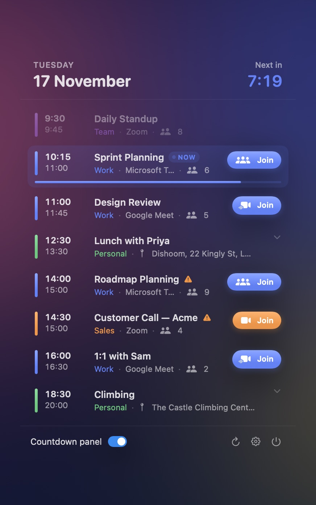
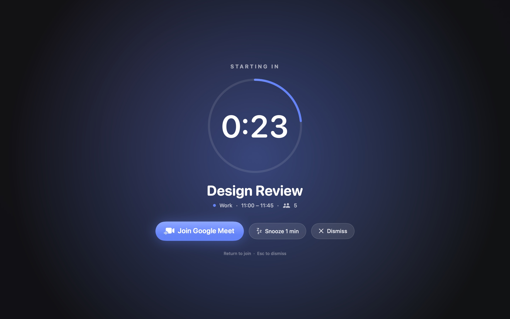

<div align="center">


# Cadence

**Your calendar, gently panicking on your behalf.**

A tiny, native macOS menu-bar app that watches every calendar you have, counts down to your next meeting,<br>
finds the join link wherever it's hiding, and — 30 seconds before you're due — takes over the whole screen so you're never late again.

<p>


</p>


</div>

<br>

<table>
<tr>
<td width="50%" valign="top">

</td>
<td width="50%" valign="top">

### 📅 Today, at a glance
Click the menu bar for a colour-coded agenda: times, calendar, meeting service or location, attendee count, a live **NOW** badge with progress, and a one-click **Join** on everything joinable. Past meetings fade; clashes get a ⚠️.

Expand an in-person meeting for a **map**, **live travel time** and a "leave in 12m" hint.

### ⏱️ A countdown that floats


A glass pill that sits above everything, on every Space. Drag it anywhere — it snaps to edges.

</td>
</tr>
</table>

## 🚨 The full-screen nudge



30 seconds before a meeting (configurable), Cadence covers every display with a countdown and a big **Join** button.
<kbd>Return</kbd> joins · <kbd>Esc</kbd> dismisses · **Snooze** nags you again a minute later.

### …but not while you're presenting

Cadence checks what you're doing before it shouts:

| You are… | What happens (default) |
|---|---|
| Just working | Full-screen alert on all displays |
| Presenting a Keynote/PowerPoint slideshow, or sharing your screen in Zoom/Teams | Displays being shown are **never** covered — a small banner appears on another display instead |
| On a call (an app is using your microphone) | Small banner, no focus stealing |
| Presenting on every display | Falls back to a macOS notification (which macOS hides from your audience) |


Each situation is configurable (full-screen / banner / notification / nothing), and **Settings → Alerts** shows a live "Right now: …" readout so you can check detection mid-presentation.

## ⚔️ Double-booked? It asks.


The moment Cadence spots two meetings that overlap — real clashes, not the same invite copied onto two calendars — a card slides in at the top right asking which one you want alerts for. Your choice sticks; the other is quietly muted (🔕 in the agenda).

<br clear="right">

## ✨ Everything else

- **🔗 Join links from anywhere.** URL field, location, or buried in an HTML invite body. Zoom, Google Meet, Microsoft Teams, Webex, GoTo, Whereby, Jitsi, Chime, Slack huddles, BlueJeans, Skype, Discord, FaceTime, Around, Tuple and RingCentral. Outlook SafeLinks, Google and Proofpoint redirect wrappers are unwrapped, and Zoom/Teams open straight in their apps.
- **⌨️ Global join shortcut.** <kbd>⌃</kbd><kbd>⌥</kbd><kbd>⌘</kbd><kbd>J</kbd> (re-bindable) joins whatever's starting in the next 10 minutes — or the meeting you're already late for.
- **🚗 "Leave now" reminders.** For in-person meetings, Cadence watches live traffic and pings you at configurable offsets before you need to leave (default: 10 minutes before, and "time to leave").
- **🔔 Heads-up notifications.** Optional nudge N minutes before each meeting (default 5).
- **🧹 Filters.** Toggle calendars; hide all-day, declined, tentative, free or link-less events; include/exclude by title keyword; minimum duration.
- **😰 A menu bar icon with feelings.** Calm, nervous at 15 minutes, sweating at 5.

<p align="center"></p>

## 🗂️ Calendar sources

| Source | How |
|---|---|
| **macOS Calendar** | Everything you've added in *System Settings → Internet Accounts*: iCloud, Google, Exchange/Outlook, CalDAV, subscriptions. Just grant access. |
| **ICS / webcal feeds** | *Settings → Accounts → Subscribed calendars.* Paste any iCalendar link — Google's "secret address in iCal format", Outlook's published ICS, team rotas, sports, holidays. Recurrence, exceptions and Windows time zones are handled. |
| **Google Calendar (direct)** | *Settings → Accounts → Google.* Optional; gives Meet links and RSVPs straight from Google. Uses your own OAuth client (see below). |

The same meeting arriving from several sources is merged automatically.

<details>
<summary><b>Setting up direct Google Calendar access</b></summary>

1. In [Google Cloud Console](https://console.cloud.google.com/), create a project and enable the **Google Calendar API**.
2. Configure the **OAuth consent screen** (External, testing) and add yourself as a test user.
3. **Credentials → Create credentials → OAuth client ID → Desktop app.**
4. Paste the client ID and secret into *Cadence → Settings → Accounts* and click **Sign in with Google**.

Cadence uses the loopback redirect + PKCE flow, asks only for `calendar.readonly`, and keeps the refresh token in your Keychain.
</details>

## 🛠️ Build & run

No Xcode project, no SwiftPM, no dependencies — just the Xcode Command Line Tools on macOS 14+.

```bash
scripts/test.sh            # 53 unit tests (Swift Testing)
scripts/build.sh --run     # build build/Cadence.app and launch it
```

```bash
CONFIG=debug scripts/build.sh                                     # debug build
CODESIGN_IDENTITY="Apple Development: you@example.com" scripts/build.sh   # stable signature
scripts/icon.sh                                                   # regenerate the app icon
build/Cadence.app/Contents/MacOS/Cadence --screenshots docs/screenshots   # regenerate these images
```

> [!TIP]
> Builds are ad-hoc signed by default, so macOS may re-ask for calendar (and Keychain) access after each rebuild. Set `CODESIGN_IDENTITY` to a real signing identity to avoid that, and copy the app to `/Applications` to use **Launch at login**.

## 🔒 Privacy

Everything runs locally. Cadence talks only to the services you connect (Google's API, your ICS feed hosts) and Apple Maps for travel times. Presentation and call detection read window positions and microphone *usage* — never screen contents or audio — and need no Screen Recording or Microphone permission.

## 🧬 How it's built

```
Sources/
├── CadenceCore/          Pure, tested logic — no UI frameworks
│   ├── MeetingLinkDetector   find & unwrap join links
│   ├── ICS                   iCalendar parser + RRULE expansion
│   ├── GoogleCalendarModels  Google API → Meeting
│   ├── Deduplication         merge copies across sources
│   ├── FilterSettings        user filters
│   ├── AlertPlanner          when the takeover fires (snooze, late wake)
│   ├── AlertPolicy           presenting/call detection → how to alert
│   └── Reminders             heads-up, leave-now, clash detection
└── Cadence/              The app
    ├── Sources/              EventKit, ICS and Google providers, OAuth, Keychain
    ├── Engine/               system context, alert routing, travel, hotkey, notifications
    └── UI/                   menu, panel, takeover, banner, clash prompt, settings
```

New sources plug in by conforming to `CalendarProvider`.

<div align="center">
<br>
<sub>Made for people who are definitely, absolutely, five minutes away.</sub>
</div>
