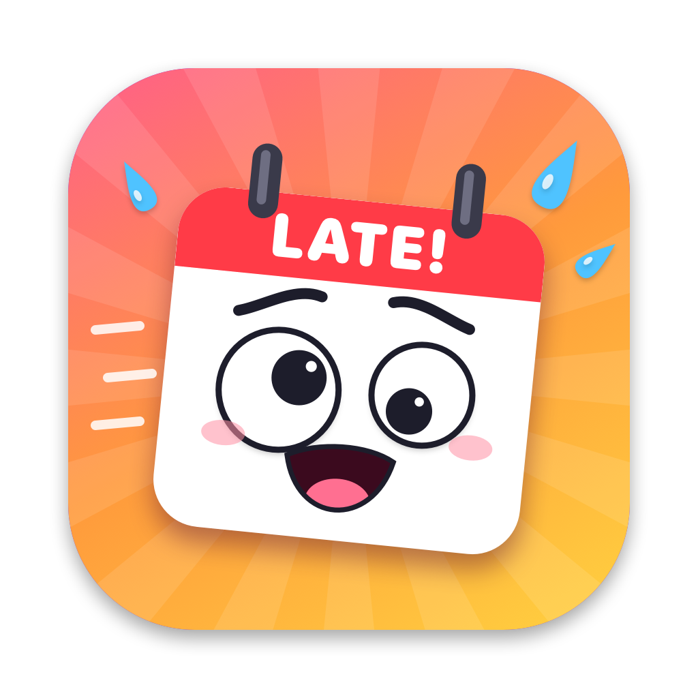
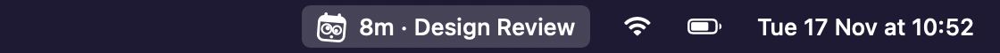
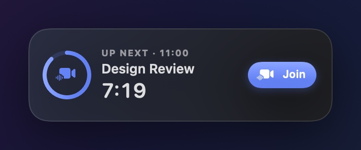
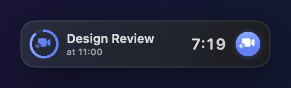
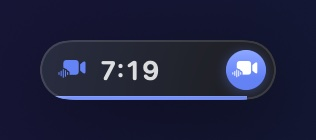
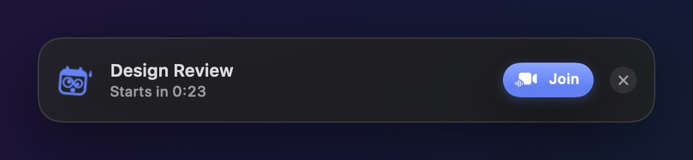
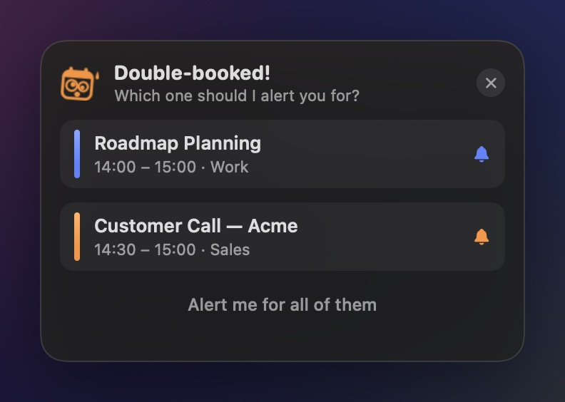
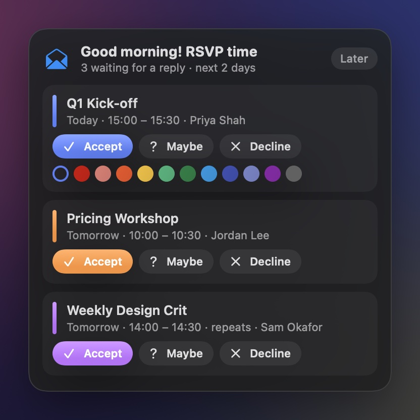
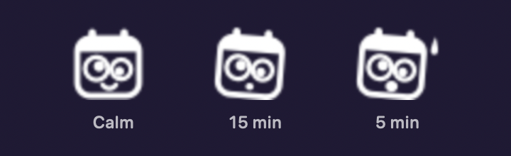

<div align="center">



# Cadence

**Your calendar, gently panicking on your behalf.**

A tiny, native macOS menu-bar app that watches every calendar you have, counts down to your next meeting,<br>
finds the join link wherever it's hiding, and — 30 seconds before you're due — takes over the whole screen so you're never late again.

<p>


<a href="https://github.com/lilmuckers/calendar-cadence/releases"></a>
<a href="https://github.com/lilmuckers/calendar-cadence/actions/workflows/ci.yml?query=branch%3Amain"></a>
</p>



</div>

<br>

<table>
<tr>
<td width="50%" valign="top">

</td>
<td width="50%" valign="top">

### 📅 Today, at a glance
Click the menu bar for a colour-coded agenda: times, calendar, meeting service or location, attendee count, a live **NOW** badge with progress, and a one-click **Join** on everything joinable. Past meetings fade; clashes get a ⚠️.

Expand an in-person meeting for a **map**, **live travel time** and a "leave in 12m" hint.

### ⏱️ A countdown that floats


A glass pill that sits above everything, on every Space. Drag it anywhere — it snaps to edges.

<p> </p>

Pick **Standard**, **Compact** or an ultra-small **Mini**, and let it **grow** as the meeting gets close (one size up at 15 minutes, full size at 5). Show it only when something starts within *N* minutes, and right-click any event to keep it — or every occurrence of it — off the panel.

</td>
</tr>
</table>

## 🚨 The full-screen nudge


30 seconds before a meeting (configurable), Cadence covers every display with a countdown and a big **Join** button.
<kbd>Return</kbd> joins · <kbd>Esc</kbd> dismisses · **Snooze** nags you again a minute later.

### …but not while you're presenting

Cadence checks what you're doing before it shouts:

| You are… | What happens (default) |
|---|---|
| Just working | Full-screen alert on all displays |
| Presenting a Keynote/PowerPoint slideshow, or sharing your screen in Zoom/Teams | Displays being shown are **never** covered — a small banner appears on another display instead |
| On a call (an app is using your microphone) | Small banner, no focus stealing |
| Presenting on every display | Falls back to a macOS notification (which macOS hides from your audience) |



Each situation is configurable (full-screen / banner / notification / nothing), and **Settings → Alerts** shows a live "Right now: …" readout so you can check detection mid-presentation.

## ⚔️ Double-booked? It asks.



The moment Cadence spots two meetings that overlap — real clashes, not the same invite copied onto two calendars — a card slides in at the top right asking which one you want alerts for. Your choice sticks; the other is quietly muted (🔕 in the agenda).

<br clear="right">

## 💌 RSVP without opening your calendar



Each morning Cadence gathers every invite still waiting for a reply and asks you, in one card: **Accept**, **Maybe** or **Decline**. The organiser gets your reply as usual. A new invite gets the same card (or a notification with reply buttons) as soon as it arrives.

- **How far ahead to look:** today, the next 2 days, a week, or all time.
- **Colour while you're at it.** Turn on the 🎨 palette next to a calendar and its invites show Google's eleven event colours too. Right-click any event for **Colour ▸** at any time.
- Replies go straight to **Google** and **Microsoft 365** accounts signed in under *Accounts*. Invites that only come through macOS Calendar open in Calendar, because Apple doesn't let other apps reply.

<br clear="right">

## 🤖 Ask your assistant about your day

Cadence includes a local [MCP](https://modelcontextprotocol.io) server, so Claude (Desktop or Code), Cursor or any other MCP client on your Mac can read your merged calendar, act on it, and hear about things as they happen. It sees exactly what Cadence sees: every source merged, filtered and de-duplicated.

**Connect.** Open *Settings → Assistants*. Cadence finds Claude Desktop, Claude Code, Cursor and Windsurf on your Mac and shows whether each one is running, set up and connected right now. **Install** adds a `cadence` server to that client's MCP config, leaving the rest of the file alone and keeping a `.cadence-backup` of the old version. Claude Code is set up through its own `claude mcp add` command. Cadence then offers to restart the client so it loads the server. If Cadence isn't in Applications, the tab offers to move it there first, so the configured path keeps working.

Prefer to do it by hand? Each client has a disclosure with the command or JSON to copy. For Claude Code:

```bash
claude mcp add --scope user cadence -- "/Applications/Cadence.app/Contents/MacOS/cadence-mcp"
```

`cadence-mcp` is a small stdio relay bundled in the app. It talks to Cadence over a Unix socket only your user can open (`~/Library/Application Support/Cadence/mcp.sock`, mode 0600), starts Cadence if it isn't running, and reconnects if Cadence restarts.

| | |
|---|---|
| **Read** | `get_agenda` · `get_next_meeting` · `get_current_meeting` · `list_invites` · `list_clashes` · `find_free_time` · `list_calendars` · `get_status` (presenting / on a call) |
| **Act** | `respond_to_invite` · `set_event_color` · `join_meeting` · `hide_from_panel` · `snooze_alert` |
| **Resources** | `cadence://agenda/today` · `agenda/tomorrow` · `next` · `invites` · `clashes` · `status` (subscribable) |
| **Prompts** | `daily_briefing` · `prepare_for_meeting` · `triage_invites` |

**You stay in charge.** Every action pops a card in Cadence naming the assistant and what it wants to do: **Allow**, **Deny** or **Always allow**. Unanswered requests are denied after a minute. Per-action auto-approval lives in *Settings → Assistants*.

**See what they did.** *Settings → Assistants → Activity* shows calls today and over the last week, actions done and denied, a chart per tool and per day, and a list of recent calls with their outcome. It can be filtered by assistant. The history stays on this Mac for 30 days and can be cleared.

**Events.** Cadence pushes `meeting.starting_soon`, `meeting.started`, `meeting.ending_soon`, `meeting.ended`, `invite.new`, `meeting.changed`, `meeting.canceled`, `clash.new`, `status.presenting` and `status.on_call`. They arrive as MCP log notifications and as `resources/updated` for subscribed resources. Clients differ in what they do with unsolicited notifications, so there's also `wait_for_event`: a long-poll tool (up to 5 minutes) that returns everything since the last call. An agent can loop on it to react to your calendar.

## ✨ Everything else

- **🔗 Join links from anywhere.** URL field, location, or buried in an HTML invite body. Zoom, Google Meet, Microsoft Teams, Webex, GoTo, Whereby, Jitsi, Chime, Slack huddles, BlueJeans, Skype, Discord, FaceTime, Around, Tuple and RingCentral. Outlook SafeLinks, Google and Proofpoint redirect wrappers are unwrapped, and Zoom/Teams open straight in their apps.
- **🧭 The right browser profile.** Several clients, several signed-in profiles? Cadence opens each meeting in the right one of your default browser (Chrome, Edge, Brave, Vivaldi or Firefox, including Firefox containers). Pick a profile per account or calendar in *Settings → Calendars*, add organizer rules like *@client.com → Client profile* in *Settings → Browser*, or right-click Join → **Join in** for one meeting or a whole series. You choose per service whether an assigned profile beats the Zoom or Teams app. With Safari as the default, links open as usual.
- **⌨️ Global join shortcut.** <kbd>⌃</kbd><kbd>⌥</kbd><kbd>⌘</kbd><kbd>J</kbd> (re-bindable) joins whatever's starting in the next 10 minutes — or the meeting you're already late for.
- **🚗 "Leave now" reminders.** For in-person meetings, Cadence watches live traffic and pings you at configurable offsets before you need to leave (default: 10 minutes before, and "time to leave").
- **🔔 Heads-up notifications.** Optional nudge N minutes before each meeting (default 5).
- **🗣️ Wrap-up nudge.** Five minutes before a meeting ends (configurable). If another one starts straight after, it says so: *"Dude, you have 5 minutes to the next meeting and you're still talking."* Its Join button opens the next meeting.
- **☀️ Morning summary & tomorrow.** A good-morning notification with how many meetings you have, when the first starts, when you're done and how many invites need a reply. In the evening (or once today is over) the agenda shows tomorrow too.
- **🎨 Event colours.** Colour an event in Google Calendar (or give it a `COLOR` in an ICS feed) and Cadence uses that colour instead of the calendar's. Toggle in *Settings → Calendars*.
- **🧹 Filters.** Toggle calendars; hide all-day, declined, tentative, free or link-less events; include/exclude by title keyword; minimum duration.
- **😰 A menu bar icon with feelings.** Calm, nervous at 15 minutes, sweating at 5.

<p align="center"></p>

## 🗂️ Calendar sources

| Source | How |
|---|---|
| **macOS Calendar** | Everything you've added in *System Settings → Internet Accounts*: iCloud, Google, Exchange/Outlook, CalDAV, subscriptions. Just grant access. |
| **ICS / webcal feeds** | *Settings → Accounts → Subscribed calendars.* Paste any iCalendar link — Google's "secret address in iCal format", Outlook's published ICS, team rotas, sports, holidays. Recurrence, exceptions and Windows time zones are handled. |
| **Microsoft 365 / Outlook (direct)** | *Settings → Accounts → Sign in with Microsoft.* Work, school or personal accounts, as many as you like. Teams links, RSVP status, replies, and Outlook category colours. Needs an app registration (see below). |
| **Google Calendar (direct)** | *Settings → Accounts → Google → Sign in with Google.* Optional, and you can add **multiple accounts** (work, personal…); gives Meet links and RSVPs straight from Google. Builds with a built-in OAuth client need nothing else; otherwise bring your own (see below). |

The same meeting arriving from several sources is merged automatically.

<details>
<summary><b>Setting up the Google OAuth client</b></summary>

If the build you're using has a Google client built in, skip this: just click **Sign in with Google**. These steps are for building Cadence yourself, or for using your own client (*Settings → Accounts → Use my own OAuth client…*).

About five minutes in [Google Cloud Console](https://console.cloud.google.com/):

1. **Create a project** (project picker → *New project*, e.g. `Cadence`) and select it.
2. **Enable the API:** *APIs & Services → Library →* **Google Calendar API** *→ Enable*.
3. **Consent screen:** *Google Auth Platform → Get started* (older consoles: *APIs & Services → OAuth consent screen*). App name `Cadence`, your email as support contact, then pick an **Audience**:
   - **Internal**: Google Workspace accounts only, signing in within your own domain. Simplest option: no test users, and sign-ins don't expire.
   - **External**: personal `@gmail.com` accounts, or more than one domain. See the note below.
4. *(Optional)* **Data Access → Add or remove scopes →** `.../auth/calendar.readonly` and `.../auth/calendar.events`. Cadence requests both anyway (the second lets it reply to invites and set event colours); adding them here makes the consent screen accurate.
5. **Create the client:** *Clients → Create client →* Application type **Desktop app**. Copy the **Client ID** and **Client secret**. You don't need a redirect URI: Desktop clients accept Cadence's `http://127.0.0.1:<port>` loopback automatically.
6. Either **build it in** for everyone who uses your build (next section), or paste both values into **Cadence → Settings → Accounts → Use my own OAuth client…**. Then click **Sign in with Google**, choose your account and **Allow**. The browser tab says *"Cadence is connected"* when it's done.

> [!IMPORTANT]
> **External apps start in "Testing" mode, and Google expires their refresh tokens after 7 days.** Cadence then shows *Not signed in* and you have to sign in again. You also have to add every account you'll use under *Audience → Test users*, or sign-in fails with *"Access blocked"*.
>
> To stop the weekly re-sign-in, click **Publish app** under *Audience* so its status becomes *In production*. You don't need Google's verification for personal use. Sign-in then shows *"Google hasn't verified this app"*: choose **Advanced → Go to Cadence (unsafe)**. That's expected, because the OAuth client is your own.

Cadence uses the loopback redirect + PKCE flow and asks for `calendar.readonly` plus `calendar.events` (to reply to invites and colour events). Accounts connected before replies existed are read-only until you click **Reconnect**. It keeps the client secret and refresh token in your Keychain; after an ad-hoc-signed rebuild, macOS may ask to allow Keychain access, so choose **Always Allow**. Add as many Google accounts as you like with **Add Another Account**; Google shows its account chooser each time. If one stops working (for example, after the 7-day Testing-mode expiry), it's marked **Reconnect** rather than removed. Meetings that appear in several accounts, or in macOS Calendar too, are merged automatically.
</details>

<details>
<summary><b>Setting up the Microsoft app registration</b></summary>

If your build has a Microsoft app built in, skip this and click **Sign in with Microsoft**. Otherwise, about three minutes in the [Microsoft Entra admin center](https://entra.microsoft.com/) (or Azure portal → *App registrations*):

1. **New registration.** Name `Cadence`. Supported account types: **Accounts in any organizational directory and personal Microsoft accounts** (or just your organisation, if that's all you need).
2. **Redirect URI:** platform **Public client/native (mobile & desktop)**, URI `http://localhost`. Microsoft accepts any port on localhost, which Cadence picks at sign-in.
3. **Register**, then copy the **Application (client) ID**. There's no secret: Cadence is a public client and signs in with PKCE.
4. *(Optional)* **API permissions → Add → Microsoft Graph → Delegated:** `Calendars.ReadWrite`, `MailboxSettings.Read`, `User.Read`, `offline_access`. Cadence requests these at sign-in anyway; some organisations need an admin to approve them first.
5. Paste the ID into **Settings → Accounts → Use my own app registration…**, or build it in with `MICROSOFT_CLIENT_ID` (next section).

`Calendars.ReadWrite` is only used to reply to invites; Cadence never edits or deletes events. `MailboxSettings.Read` reads your Outlook category colours.
</details>

## 🛠️ Build & run

No Xcode project, no SwiftPM, no dependencies — just the Xcode Command Line Tools on macOS 14+.

```bash
scripts/test.sh            # 88 unit tests (Swift Testing)
scripts/build.sh --run     # build build/Cadence.app and launch it
```

### Building in a Google OAuth client

Save the client as `Support/Secrets.env` (git-ignored; `Support/Secrets.env.example` shows the format), or export the same two variables:

```bash
GOOGLE_CLIENT_ID=1234-abc.apps.googleusercontent.com
GOOGLE_CLIENT_SECRET=GOCSPX-…
MICROSOFT_CLIENT_ID=00000000-0000-0000-0000-000000000000   # optional
```

`scripts/build.sh` writes them into the app's `Info.plist`, so users only see **Sign in with Google** / **Sign in with Microsoft**. A client someone enters in Settings still takes priority.

> [!NOTE]
> Google treats Desktop-app client secrets as non-confidential: PKCE protects the sign-in itself, and anyone with the `.app` can read the secret. Keep it out of git anyway, so nobody else's builds use your project's quota.
> To let people outside your test-user list sign in, **publish** the consent screen. Unverified apps are capped at 100 users and show a warning. Above that, Google requires verification for the `calendar.readonly` scope: a privacy policy, a homepage, and a demo video.

### More build options

```bash
CONFIG=debug scripts/build.sh                                     # debug build
CODESIGN_IDENTITY="Apple Development: you@example.com" scripts/build.sh   # stable signature
scripts/icon.sh                                                   # regenerate the app icon
build/Cadence.app/Contents/MacOS/Cadence --screenshots docs/screenshots   # regenerate these images
```

### CI and releases

- **CI** ([`ci.yml`](.github/workflows/ci.yml)) runs `scripts/test.sh` on every pull request and push to `main`. It only runs the tests; it doesn't build the app.
- **Release labels.** Every PR needs exactly one of `major`, `minor` or `patch` ([`pr-labels.yml`](.github/workflows/pr-labels.yml) fails the check otherwise). Add `skip-changelog` to leave a PR out of the release notes. Run *Actions → Sync labels* once to create the labels.
- **Release** ([`release.yml`](.github/workflows/release.yml)): start it from *Actions → Release → Run workflow* on `main`. It:
  1. Works out the next version from the highest label on PRs merged since the last `vX.Y.Z` tag (`scripts/next-version.sh`; the first release uses the version in `Info.plist`). You can force a bump instead.
  2. Runs the tests, builds `Cadence.app`, and packages `Cadence-<version>.dmg`, `Cadence-<version>.zip` and `SHA256SUMS.txt`.
  3. Tags the commit `v<version>` and publishes a GitHub release with those files attached. The notes come from [`RELEASE_NOTES_TEMPLATE.md`](.github/RELEASE_NOTES_TEMPLATE.md), with a changelog of the merged PRs grouped by label ([`.github/release.yml`](.github/release.yml)).
  - `dry_run` builds everything without tagging or releasing; `draft` creates the release as a draft.
- **Signing.** Signing and notarization turn on when the Developer ID and notary secrets listed at the top of `release.yml` are added. Until then builds are ad-hoc signed and published as **pre-releases**, and Gatekeeper blocks them on other Macs.

Preview the next version or the release notes locally:

```bash
scripts/next-version.sh
scripts/release-notes.sh v0.1.0 "" patch false /dev/null   # tag, previous tag, bump, notarized, checksums file
```

> [!TIP]
> Builds are ad-hoc signed by default, so macOS may re-ask for calendar (and Keychain) access after each rebuild. Set `CODESIGN_IDENTITY` to a real signing identity to avoid that, and copy the app to `/Applications` to use **Launch at login**.

## 🔒 Privacy

Everything runs locally. Cadence talks only to the services you connect (Google's and Microsoft's APIs, your ICS feed hosts) and Apple Maps for travel times. Presentation and call detection read window positions and microphone *usage* — never screen contents or audio — and need no Screen Recording or Microphone permission. The assistant server listens only on a private Unix socket (no network port). What an assistant reads goes wherever that assistant sends it, so connect only ones you trust.

## 🧬 How it's built

```
Sources/
├── CadenceCore/          Pure, tested logic — no UI frameworks
│   ├── MeetingLinkDetector   find & unwrap join links
│   ├── ICS                   iCalendar parser + RRULE expansion
│   ├── GoogleCalendarModels  Google API → Meeting
│   ├── Deduplication         merge copies across sources
│   ├── FilterSettings        user filters
│   ├── AlertPlanner          when the takeover fires (snooze, late wake)
│   ├── AlertPolicy           presenting/call detection → how to alert
│   ├── MicrosoftGraphModels  Microsoft Graph → Meeting
│   ├── Invites               RSVP horizon, invite merging, event colour palette
│   ├── Reminders             heads-up, leave-now, wrap-up, morning summary, clashes
│   ├── PanelPlanner          what the countdown panel shows, and how big
│   └── MCP*                  MCP protocol, tools catalogue, events, free-time finder
└── Cadence/              The app
    ├── Sources/              EventKit, ICS, Google and Microsoft providers, OAuth, Keychain
    ├── Engine/               system context, alert routing, travel, hotkey, notifications
    ├── MCP/                  Unix-socket bridge and tool implementations for assistants
    └── UI/                   menu, panel, takeover, banner, clash, invite and approval cards, settings
Sources/CadenceMCP/       cadence-mcp, the stdio relay bundled in the app
```

New sources plug in by conforming to `CalendarProvider`. Ideas that are parked live in [BACKLOG.md](BACKLOG.md).

<div align="center">
<br>
<sub>Made for people who are definitely, absolutely, five minutes away.</sub>
</div>
